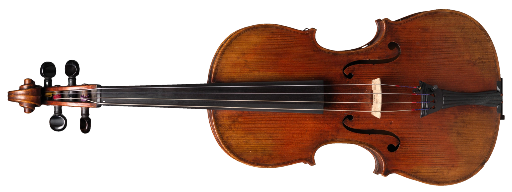
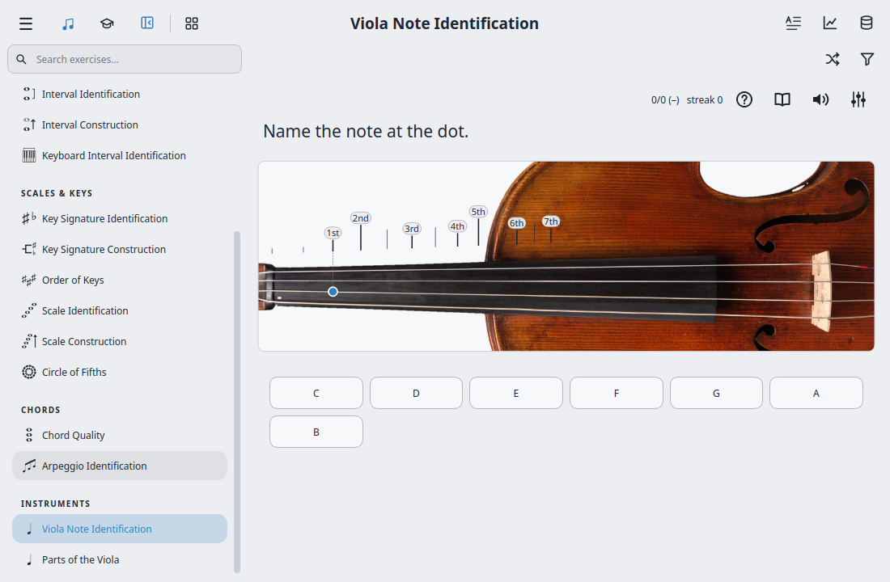
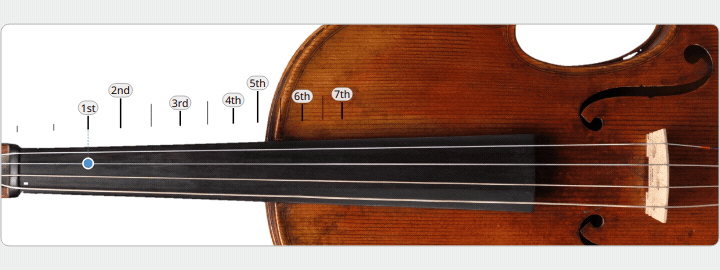
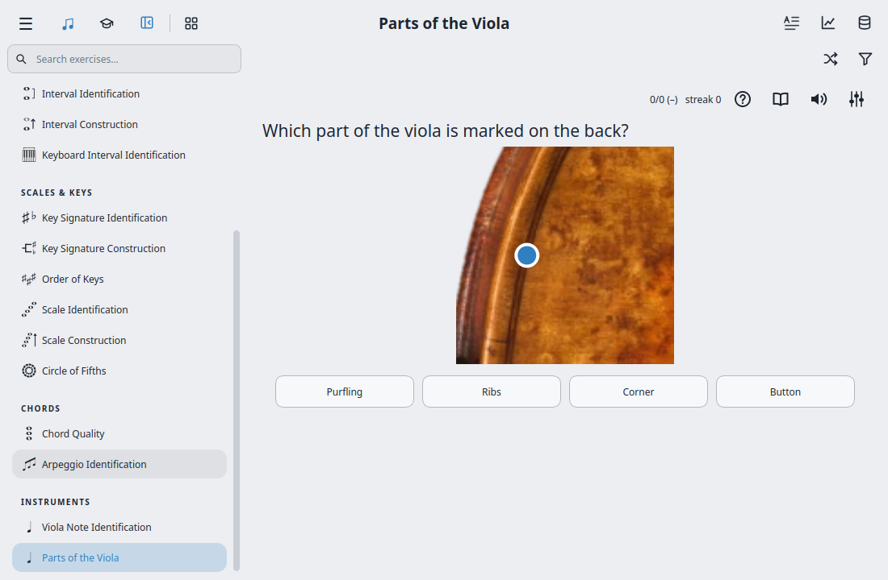
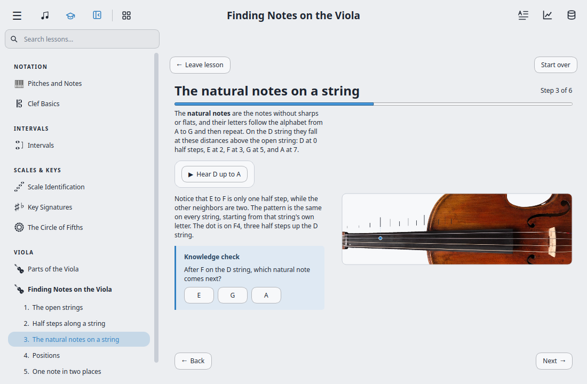
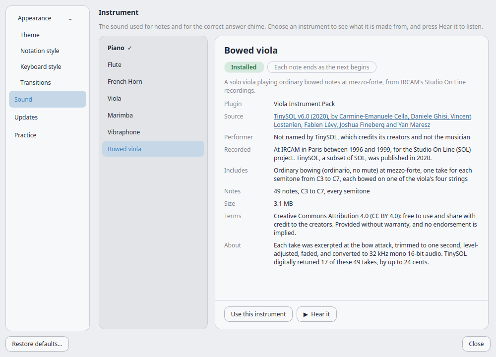

# Viola for Alto

<p align="center">
  
</p>

Learn the viola by looking at one. This plugin adds a real viola to [Alto](https://github.com/altosaurus/alto), the music theory
trainer, so you can practice finding notes on the fingerboard, learn the names of the instrument's parts, and hear every note
played by an actual viola. It is free, and it works offline.

**What you get**

- A fingerboard exercise that marks a dot on a photograph of a viola and asks which note it is.
- A parts exercise with 30 marked parts, from the scroll to the button.
- Two short lessons with knowledge checks, and 14 glossary entries.
- 49 recordings of a bowed viola, every semitone from C3 to C7, which you can also use as Alto's sound everywhere.

<p align="center">
  <a href="https://github.com/altosaurus/viola-plugin-tutorial/releases/latest/download/viola.zip"><b>Download viola.zip</b></a>
</p>

## Name the note under the dot

**Viola Note Identification** puts a dot on the viola's fingerboard. Name the note. Along the top of the neck a ruler shows
where each position begins, from 1st to 7th, and a faint line leads from the dot to its tick, so you learn to read the neck
by position the way a player does.

<picture>
  <source media="(prefers-color-scheme: dark)" srcset="readme/viola-note-dark.png">
  
</picture>

A correct answer plays the recording of that exact note, and the string you marked vibrates from the dot to the bridge for as
long as the note sounds.

<p align="center">
  
</p>

Make it fit your practice from the exercise's settings:

- **Range.** Choose how far up the neck you want to be asked, on the alto clef staff.
- **Accidentals.** Add the sharps and flats between the natural notes.
- **Octave.** Name the octave as well as the letter.
- **Viola sound.** Pick which instrument plays. See [Choose the sound](#choose-the-sound).

## Learn the parts of the viola

**Parts of the Viola** marks one part at a time and asks you to name it. There are 30 of them: the scroll, pegbox, pegs, nut,
fingerboard, each string, the bridge, f-holes, tailpiece, fine tuner, bouts, corner, purfling and top plate on the front, and
the neck, button, back plate and ribs on a second photograph of the back. Small parts are shown close up, so you can see what
you are naming.

<picture>
  <source media="(prefers-color-scheme: dark)" srcset="readme/viola-parts-dark.png">
  
</picture>

## Two lessons

Lessons walk you through a topic one step at a time, with a picture, a short explanation, a button to hear the notes, and a
knowledge check you answer by clicking.

- **Parts of the Viola.** Seven steps from the front of the instrument to the head, the neck, the body, the back, and the
  bridge and tailpiece, ending with a quiz.
- **Finding Notes on the Viola.** Six steps on the open strings, half steps, the natural notes on a string, positions, and why
  one note can be played in two places.

<picture>
  <source media="(prefers-color-scheme: dark)" srcset="readme/viola-lesson-dark.png">
  
</picture>

Fourteen glossary entries explain the terms you meet, from *scroll* and *bridge* to *open string* and *position*. Each one links
to the exercises and lessons that use it.

## Choose the sound

The plugin adds **Bowed viola** to Alto's sound settings. Open **Menu → Settings → Sound**, select it, and press **Hear it** to
listen. Choose **Use this instrument** to hear the viola for notes in every other exercise as well.

<picture>
  <source media="(prefers-color-scheme: dark)" srcset="readme/viola-sound-dark.png">
  
</picture>

Each viola exercise also has its own sound row in its settings. It opens a list with this plugin's viola first, then any other
violas you have installed, then every other instrument. You can compare recordings from different plugins without leaving the
exercise.

## Install

You need Alto with plugin support.

1. [Download `viola.zip`](https://github.com/altosaurus/viola-plugin-tutorial/releases/latest/download/viola.zip) from the latest release.
2. In Alto, open **Menu → Tools → Plugins…** and choose **Install plugin from file…**.
3. Select the ZIP and restart Alto.
4. Open **Instruments** in the sidebar. **Viola Note Identification** and **Parts of the Viola** are there, and the lessons and
   glossary entries appear in **Lessons** and **Glossary**.

To remove it, open the same dialog and uninstall **Viola Instrument Pack**. Your practice history is kept.

## Build your own

This repository is also the tutorial for making a plugin like this one. It walks through a viola plugin that asks the learner
to name a note on the D string, then adds a picture question about the bridge. You reuse the artwork and recordings from the
example and write your own manifest.

| Path | Contents |
| --- | --- |
| `docs/plugins/viola.md` | The tutorial. It still uses Alto's site front matter and `relative_url` links. |
| `docs/assets/plugins/viola/` | The editable example pack: `pack.json`, artwork, animation, icon, recordings, and `CREDITS.txt`. |
| `.github/workflows/release.yml` | Builds `viola.zip` from the pack folder and publishes it as a release asset. |
| `docs/assets/plugins/viola-*.png` | The close view of the fingerboard that the tutorial shows. |
| `docs/assets/img/plugin-viola-*.png` | The two screenshots the tutorial shows, each in a light and a dark theme. `scripts/screenshots.py` makes them from a checkout of Alto. |
| `docs/assets/plugins/viola-correct-answer.gif`, `readme/` | The animation and pictures on this page only. |

The Alto docs website brings in `docs/plugins/viola.md` and only the files that page refers to. The loose sound files, this page's
pictures and everything else stay in this repository. Push a change here, then run Alto's **Docs** workflow to update the site.

The install file is not stored here. Push a tag such as `v1.0.0` and the Release workflow builds `viola.zip` from the pack folder,
checks that `pack.json` is at its root and that every file it names is there, and publishes a GitHub release with the ZIP attached.
To build it yourself, for a test install, zip the folder's contents:

```sh
cd docs/assets/plugins/viola && zip -X -D -r /tmp/viola.zip .
```

The paths match Alto's `docs/` folder, so a file here can be compared with its original. The plugin API reference stays in Alto
at `docs/plugins/api.md`.

## Credits and licenses

The recordings are from [TinySOL](https://doi.org/10.5281/zenodo.3685367), a subset of IRCAM's Studio On Line (SOL) recordings
made at IRCAM in Paris between 1996 and 1999. TinySOL was published in 2020 by Carmine-Emanuele Cella, Daniele Ghisi, Vincent
Lostanlen, Fabien Lévy, Joshua Fineberg and Yan Maresz. TinySOL is licensed
[CC BY 4.0](https://creativecommons.org/licenses/by/4.0/), which lets you adapt and share the audio with credit. Each note was
excerpted at the bow attack, trimmed to one second, level-adjusted, faded, and converted to 32 kHz mono. The files in `sounds/`
are named after the original takes, which `docs/assets/plugins/viola/CREDITS.txt` lists.

The photographs show an 1893 viola by August Martin Gemünder from the Metropolitan Museum of Art's Open Access collection (public
domain). The front and the back were cut out from their studio backdrops and turned on their sides.
[Museum record](https://www.metmuseum.org/art/collection/search/504403)

Keep `CREDITS.txt` with the recordings wherever you share them.

## License

The tutorial, the manifests and the other original files in this repository are released under the [MIT License](LICENSE).
The recordings and the photographs are not covered by it. They keep the licenses described under
[Credits and licenses](#credits-and-licenses): the recordings are CC BY 4.0 and need credit wherever you share them, and the
photographs are public domain.
